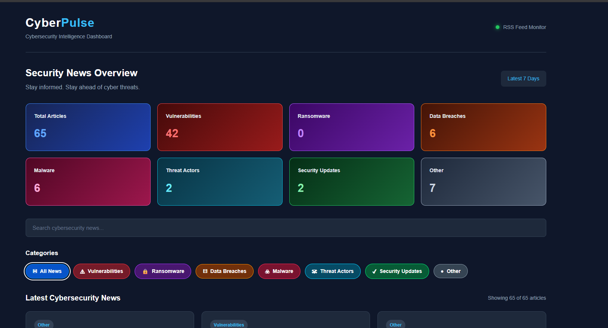

# Cyber Pulse - Cybersecurity Intelligence Dashboard

Cyber Pulse is a cybersecurity news aggregation dashboard developed with the assistance of AI throughout the development process.

AI was used as a development companion to help with coding, debugging, understanding concepts, solving implementation challenges, and improving the overall project architecture

**Live Dashboard:** [Cyber Pulse](https://varunnshenoy.github.io/Cyber-Pulse/)

## Overview

Cyber Pulse is a personal cybersecurity intelligence project designed to make it easier to follow security developments from different news sources in one place.

The project uses a Python backend to collect and process RSS feeds, while a JavaScript frontend presents the articles through an interactive dashboard.

News collection and website deployment are automated using GitHub Actions.



## Features

- **Automated News Collection:** Fetches cybersecurity news from RSS feeds.
- **Article Categorization:** Organizes articles into categories.
- **Duplicate Filtering:** Removes duplicate articles based on their URLs.
- **Time-Based Filtering:** Focuses on articles published within the last seven days.
- **Interactive Dashboard:** Displays article statistics and news cards.
- **Search Functionality:** Search articles by title, summary, source, or category.
- **Category Filters:** Filter articles by cybersecurity topic.
- **Automated Updates:** GitHub Actions runs the news collection workflow daily.
- **Online Deployment:** Dashboard hosted using GitHub Pages.

## Technology Stack

| Technology | Purpose |
|---|---|
| Python | RSS collection and article processing |
| JavaScript | Dashboard functionality and filtering |
| HTML | Dashboard structure |
| CSS | Dashboard styling |
| RSS | News collection |
| Git & GitHub | Version control |
| GitHub Actions | Workflow automation |
| GitHub Pages | Website hosting |

## Architecture

```text
RSS News Sources
       |
       v
Python Backend
(fetch_feeds.py)
       |
       v
Article Processing
- Date filtering
- Categorization
- Deduplication
       |
       v
feeds.json
       |
       v
JavaScript Frontend
       |
       v
Cyber Pulse Dashboard
       |
       v
GitHub Pages
```

## Current News Sources

- [The Hacker News](https://thehackernews.com/)
- [BleepingComputer](https://www.bleepingcomputer.com/)

## Automation

Cyber Pulse uses two GitHub Actions workflows:

**1. News Collection**
- Runs automatically every day at 02:30 UTC (08:00 IST).
- Executes the Python news collection script.
- Updates `feeds.json`.
- Commits and pushes changes when new data is available.

**2. Dashboard Deployment**
- Automatically deploys the website when relevant frontend files or `feeds.json` are updated.
- Publishes the dashboard through GitHub Pages.

Both workflows can also be triggered manually through GitHub Actions.

## Project Structure

```text
Cyber-News-Dashboard/
│
├── .github/
│   └── workflows/
│       ├── update-feeds.yml
│       └── deploy-pages.yml
│
├── frontend/
│   ├── index.html
│   ├── style.css
│   └── script.js
│
├── fetch_feeds.py
├── feeds.json
├── requirements.txt
├── test_rss.py
├── .gitignore
└── README.md
```

## Run Locally

**Prerequisites**
- Python 3
- Git

**1. Clone the repository**

```bash
git clone https://github.com/VarunNShenoy/Cyber-Pulse.git
cd Cyber-Pulse
```

**2. Create a virtual environment**

Windows:

```powershell
python -m venv .venv
.venv\Scripts\Activate.ps1
```

**3. Install dependencies**

```bash
pip install -r requirements.txt
```

**4. Fetch the latest news**

```bash
python fetch_feeds.py
```

**5. Start the local web server**

```bash
python -m http.server 8000
```

Open:

```text
http://localhost:8000/frontend/
```

## Future Improvements

- Integrate additional cybersecurity RSS sources.
- Introduce an AI-powered cybersecurity news assistant.
- Improve article categorization.
- Add more advanced search and filtering capabilities.

## Author

Developed as a personal project to explore cybersecurity news aggregation, Python automation, JavaScript, and CI/CD workflows.

**GitHub:** [VarunNShenoy](https://github.com/VarunNShenoy)

**Live Project:** [Cyber Pulse Dashboard](https://varunnshenoy.github.io/Cyber-Pulse/)